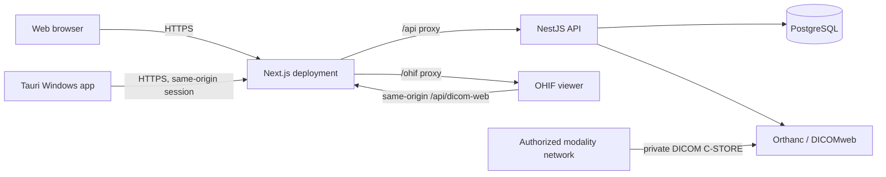

# Axis — Teleradiology PACS Workflow & Clinical Reporting Platform

> **AXIS** is an end-to-end teleradiology PACS workflow management and clinical
> reporting platform. It orchestrates the full lifecycle of diagnostic imaging
> studies — from hospital intake through radiologist reading, report generation,
> critical finding escalation, and delivery — within a single, auditable system.

Axis is designed for teleradiology groups that manage reading workflows across
multiple hospitals. It provides real-time worklist management, structured
reporting with version control, automated routing rules, turnaround-time (TAT)
analytics, and HIPAA-aligned audit logging.

---

## Table of Contents

- [Architecture](#architecture)
- [Technology Stack](#technology-stack)
- [Repository Structure](#repository-structure)
- [Local Setup](#local-setup)
- [Environment Variables](#environment-variables)
- [Docker Services](#docker-services)
- [Database Schema](#database-schema)
- [Orthanc & DICOMweb](#orthanc--dicomweb)
- [OHIF Viewer Integration](#ohif-viewer-integration)
- [Desktop Client (Windows)](#desktop-client-windows)
- [Production Deployment](docs/PRODUCTION_DEPLOYMENT.md)
- [Production Checklist](docs/PRODUCTION_CHECKLIST.md)
- [Synthetic Data Policy](#synthetic-data-policy)
- [Authentication](#authentication)
- [API Endpoints](#api-endpoints)
- [Production Considerations](#production-considerations)
- [Known Limitations](#known-limitations)
- [Project Status](#project-status)

---

## Architecture




Web and desktop use the same authenticated Next.js origin. The browser never
connects directly to PostgreSQL or Orthanc; OHIF DICOMweb requests pass through
the NestJS authorization proxy. See the [production topology](docs/PRODUCTION_DEPLOYMENT.md).
---

## Technology Stack

| Layer          | Technology                                         |
| -------------- | -------------------------------------------------- |
| **Frontend**   | Next.js 14 (App Router), React 18, TypeScript 5.5  |
| **Styling**    | Tailwind CSS 3.4, clsx, Lucide React icons         |
| **State**      | Zustand (client), TanStack React Query (server)     |
| **Backend**    | NestJS 10, TypeScript 5.5, class-validator          |
| **ORM**        | Prisma 5.15                                        |
| **Database**   | PostgreSQL 16 (Alpine)                             |
| **PACS**       | Orthanc (jodogne/orthanc-plugins), DICOMweb        |
| **Viewer**      | OHIF Viewer (standalone)                           |
| **Desktop**     | Tauri 2 (Rust), WebView2, NSIS installer           |
| **Auth**       | NestJS guards with an httpOnly session cookie      |
| **Local infrastructure** | PostgreSQL, Orthanc, OHIF; see [infra runbook](infra/README.md) |
| **Monorepo**   | pnpm 9+ workspaces                                 |
| **Infra**      | Docker Compose                                     |

---

## Repository Structure

```
axis-pacs/
├── apps/
│   ├── web/                          # Next.js frontend
│   │   ├── src/
│   │   │   ├── app/                  # App Router pages
│   │   │   │   ├── (dashboard)/      # Authenticated dashboard routes
│   │   │   │   │   ├── worklist/     # Radiologist worklist
│   │   │   │   │   ├── queue/        # Personal reading queue
│   │   │   │   │   ├── reading/      # Reading room (DICOM viewer + reporting)
│   │   │   │   │   ├── reports/      # Report management & per-study reports
│   │   │   │   │   ├── hospitals/    # Hospital management & tracker
│   │   │   │   │   ├── analytics/    # TAT, modality, SLA dashboards
│   │   │   │   │   ├── audit/        # Audit log viewer
│   │   │   │   │   └── settings/     # Routing rules, AI, users, audit config
│   │   │   │   └── layout.tsx        # Root layout
│   │   │   ├── components/
│   │   │   │   ├── admin/            # RoutingRuleBuilder, AdminTabs, RoleBadge
│   │   │   │   ├── hospital/         # HospitalStudyTimeline, StudyPipeline
│   │   │   │   ├── layout/           # AppShell, NavigationRail, TopBar
│   │   │   │   ├── reading/          # OHIF viewer, report panel, sign-off
│   │   │   │   ├── report/           # ReportEditor, VersionHistory, CriticalFinding
│   │   │   │   └── ui/               # AcuityPulse, Badge, FilterBar, Skeleton
│   │   │   └── lib/
│   │   │       ├── api-client.ts     # HTTP client
│   │   │       ├── query-client.ts   # React Query setup
│   │   │       └── store.ts          # Zustand global state
│   │   ├── tailwind.config.ts
│   │   ├── next.config.mjs
│   │   └── package.json
│   │
│   ├── api/                          # NestJS backend
│   │   ├── src/
│   │   │   ├── main.ts               # Bootstrap, global prefix /api
│   │   │   ├── app.module.ts         # Root module
│   │   │   ├── prisma/               # PrismaModule, PrismaService
│   │   │   ├── studies/              # CRUD, status transitions, series
│   │   │   ├── worklist/             # Filtered list, assignment
│   │   │   ├── reports/              # Create, sign-off, amend, versioning
│   │   │   ├── users/                # User CRUD, role management
│   │   │   ├── hospitals/            # Hospital & site listing
│   │   │   ├── audit/                # Audit log queries
│   │   │   ├── analytics/            # Overview, TAT, hospital performance
│   │   │   ├── ai/                   # AI job tracking (placeholder)
│   │   │   └── common/
│   │   │       ├── filters/          # HttpExceptionFilter
│   │   │       └── interceptors/     # AuditInterceptor
│   │   ├── prisma/
│   │   │   ├── schema.prisma         # Full database schema
│   │   │   └── seed.ts               # Synthetic seed data
│   │   └── package.json
│
│   └── desktop/                      # Tauri 2 Windows client
│       ├── src-tauri/
│       │   ├── src/
│       │   │   ├── main.rs           # Windows entry point
│       │   │   ├── lib.rs            # Window, navigation policy, plugins
│       │   │   └── server_url.rs     # Deployment URL resolution (unit tested)
│       │   ├── splash/index.html     # Shown while connecting / unconfigured
│       │   ├── capabilities/         # Grants no native access to remote content
│       │   ├── icons/                # Windows icon set
│       │   └── tauri.conf.json
│       └── package.json
│
├── packages/
│   └── types/                        # Shared TypeScript type definitions
│       ├── src/                      # Study, Report, User, Worklist, etc.
│       └── package.json
│
├── docs/
│   └── DESKTOP.md                    # Desktop architecture, config, build
│
├── infra/
│   └── orthanc/
│       └── orthanc.json              # Orthanc DICOMweb configuration
│
├── docker-compose.yml                # All infrastructure services
├── pnpm-workspace.yaml
├── pnpm-lock.yaml
├── package.json                      # Root scripts (dev, build, db:*)
├── .env.example
└── .gitignore
```

---

## Local Setup

### Prerequisites

| Tool     | Minimum Version | Check Command     |
| -------- | --------------- | ----------------- |
| Node.js  | 20+             | `node --version`  |
| pnpm     | 9+              | `pnpm --version`  |
| Docker   | 24+             | `docker --version`|
| Docker Compose | v2.17+    | `docker compose version` |

### 1. Clone and Install

```bash
git clone <repository-url> axis-pacs
cd axis-pacs
pnpm install
```

### 2. Configure Environment

```bash
cp .env.example .env
```

Replace the PostgreSQL password placeholder and keep it in sync with
`DATABASE_URL`. `.env.example` contains no deployable secrets.

### 3. Start Infrastructure

```bash
docker compose config --quiet
docker compose up -d --wait postgres orthanc ohif
```

This starts only the application dependencies and preserves their named data
volumes. Verify service health:

```bash
docker compose ps
```

### 4. Set Up Database

```bash
# Generate the Prisma client
pnpm db:generate

# Apply checked-in migrations without creating new migrations
pnpm db:migrate:deploy

# Seed the database with synthetic data
pnpm db:seed
```

### 5. Start the Application

```bash
pnpm dev
```

The frontend is available at **http://localhost:3000** and the API at
**http://localhost:4000/api**.

### Available Scripts

| Command            | Description                                    |
| ------------------ | ---------------------------------------------- |
| `pnpm dev`         | Start Next.js dev server (port 3000)            |
| `pnpm build`       | Build types then Next.js production bundle      |
| `pnpm lint`        | Run ESLint across all packages                  |
| `pnpm typecheck`   | Run TypeScript type checking across all packages|
| `pnpm test`        | Run test suites across all packages             |
| `pnpm db:generate` | Generate Prisma client                          |
| `pnpm db:migrate`  | Run Prisma migrations (dev)                     |
| `pnpm db:seed`     | Seed database with synthetic data               |
| `pnpm desktop:dev` | Run the Tauri desktop shell (starts web dev too) |
| `pnpm desktop:build` | Build the desktop bundle for the host platform |
| `pnpm desktop:build:win` | Windows x64 release NSIS installer          |
| `pnpm desktop:build:win:debug` | Windows x64 debug NSIS installer       |
| `pnpm desktop:icon` | Regenerate the Tauri icon set from `source.svg`|

---

## Environment Variables

`.env.example` is development-only. Staging and production settings belong in
per-environment deployment configuration and secret stores. See the
[environment matrix](docs/PRODUCTION_DEPLOYMENT.md#environment-matrix).

| Variable | Development | Production handling |
| --- | --- | --- |
| `AXIS_ENV` / `NODE_ENV` | `development` | `staging` or `production`, with `NODE_ENV=production`. |
| `NEXT_PUBLIC_APP_URL` | `http://localhost:3000` | Public HTTPS web origin. |
| `NEXT_PUBLIC_API_URL` | `http://localhost:4000/api` | Next server rewrite target; no credentials; configured per build. |
| `OHIF_URL` | `http://localhost:3001` | Private OHIF upstream for the Next rewrite. |
| `PORT` / `API_PORT` | `4000` | NestJS listener port. |
| `DATABASE_URL` | Local development DSN | Private secret-managed PostgreSQL connection. |
| `AUTH_SECRET` | Empty; generated per process | Unique random secret from a secret manager; never exposed to the frontend. |
| `AXIS_APP_VERSION` | pnpm package version | Root release SemVer; required for staging/production API logs. |
| `CORS_ORIGIN` | `http://localhost:3000` | Exact public origin allow-list. |
| `ORTHANC_URL` | `http://localhost:8042` | Private API-to-Orthanc service URL. |
| `ORTHANC_USERNAME` / `ORTHANC_PASSWORD` | Development credentials | Secret-managed API credentials. |
| `TRUST_PROXY` | Unset | Actual proxy hop count when deployed behind ingress. |
| `AXIS_DESKTOP_SERVER_URL` | Loopback | Optional installed-client HTTPS origin; `desktop.json` is preferred. |
| `NEXT_PUBLIC_DESKTOP_API_URL` | Empty | Keep empty so both clients use same-origin `/api`. |

Version and environment browser values are generated from the root version and
`AXIS_ENV`. The current runtime derives DICOMweb from `ORTHANC_URL`; the
template's legacy `DICOMWEB_URL` and `NEXT_PUBLIC_OHIF_URL` are not part of the
active PACS request path.

---

## Docker Services

The local stack runs PostgreSQL, Orthanc, and OHIF. Ports for PostgreSQL,
Orthanc HTTP, and OHIF bind to loopback; DICOM C-STORE remains on port 4242.
PostgreSQL and Orthanc use persistent named volumes. See the
[infrastructure runbook](infra/README.md) for environment variables, health
checks, troubleshooting, start/stop commands, and omitted-service rationale.

---

## Database Schema

The Prisma schema (`apps/api/prisma/schema.prisma`) defines the following
core models:

### Core Entities

| Model            | Description                                                   |
| ---------------- | ------------------------------------------------------------- |
| `User`           | Platform users with roles (Admin, Coordinator, Radiologist, Technician, Hospital User) |
| `Hospital`       | Hospital organizations with timezone and sites                |
| `Site`           | Physical locations within a hospital                          |
| `Patient`        | Patient demographics linked to a hospital                     |
| `Study`          | DICOM imaging studies with metadata, priority, status, SLA   |
| `Series`         | DICOM series within a study                                   |
| `Instance`       | Individual DICOM instances (slices/frames)                    |
| `WorklistItem`   | Reading queue entry tracking TAT and SLA                      |
| `Report`         | Clinical reports with versioning and critical finding flags   |
| `ReportVersion`  | Immutable version snapshots of reports                        |
| `AuditLog`       — HIPAA-aligned audit trail of all actions           |
| `RoutingRule`    | Automated study routing rules (conditions + actions as JSON)  |
| `DeliveryAttempt`| Report delivery attempts to hospitals                         |
| `AIJob`          | AI/ML processing job tracking (anatomy detection, screening) |

### Key Enums

| Enum            | Values                                                             |
| --------------- | ------------------------------------------------------------------ |
| `UserRole`      | `ADMIN`, `COORDINATOR`, `RADIOLOGIST`, `TECHNICIAN`, `HOSPITAL_USER` |
| `StudyStatus`   | `NEW`, `VALIDATED`, `UNASSIGNED`, `ASSIGNED`, `IN_READING`, `FINAL`, `AMENDED`, `DELIVERED` |
| `StudyPriority` | `STAT`, `URGENT`, `ROUTINE`                                        |
| `ReportStatus`  | `DRAFT`, `PENDING_SIGNOFF`, `FINAL`, `AMENDED`                     |
| `Modality`      | `CT`, `MRI`, `XR`, `US`, `NM`, `PET`, `MG`, `DX`, `CR`, `Fluoro`  |
| `Subspecialty`  | `NEURO`, `MSK`, `CHEST`, `ABDOMEN`, `CARDIOVASCULAR`, `MAMMOGRAPHY`, `MUSCULOSKELETAL`, `GENERAL`, `PEDIATRIC`, `ONCOLOGY`, `INTERVENTIONAL` |

### Study Status Lifecycle

```
NEW → VALIDATED → UNASSIGNED → ASSIGNED → IN_READING → FINAL → AMENDED → DELIVERED
```

---

## Orthanc & DICOMweb

Axis uses [Orthanc](https://www.orthanc-server.com/) as its DICOM archive
and DICOMweb server. The configuration is in `infra/orthanc/orthanc.json`.

### DICOMweb Endpoints

| Operation  | Method | Endpoint                          |
| ---------- | ------ | --------------------------------- |
| Search     | GET    | `/dicom-web/studies`              |
| Study metadata | GET | `/dicom-web/studies/{uid}`     |
| Series list | GET   | `/dicom-web/studies/{uid}/series` |
| Instances  | GET    | `/dicom-web/series/{uid}/instances` |
| Retrieve   | GET    | `/dicom-web/studies/{uid}` (Accept: multipart/related) |
| Store      | POST   | `/dicom-web/stow-rs/studies`      |

### Orthanc Configuration Highlights

- DICOMweb is enabled with QIDO-RS, WADO-RS, and STOW-RS
- All DICOMweb endpoints are rooted at `/dicom-web`
- DICOM C-STORE listener on port `4242`
- Authentication is disabled by default for local development
- Default credentials: `orthanc` / `orthanc`

### Uploading Test DICOM Data

You can push DICOM files to Orthanc via STOW-RS:

```bash
curl -X POST http://localhost:8042/dicom-web/stow-rs/studies \
  -u orthanc:orthanc \
  -H "Content-Type: multipart/related; type=application/dicom" \
  --data-binary @path/to/dicom-file.dcm
```

---

## OHIF Viewer Integration

Axis integrates with the [OHIF Viewer](https://ohif.org/) for interactive
DICOM image viewing within the reading room.

### Setup

The OHIF Viewer runs as a standalone application (default port `3001`).
Configure its DICOMweb source to point at the Orthanc instance:

```bash
# In your OHIF config (.env or config.json):
DICOM_WEB_ROOT=http://localhost:8042/dicom-web
```

### Embedding in the Reading Room

The reading room page (`/reading/[studyUid]`) includes an
`OHIFViewerPlaceholder` component that will be replaced with a full
`<iframe>` or modal embed once the OHIF instance is configured. The viewer
receives the study UID and loads images via DICOMweb WADO-RS.

### Launching OHIF Locally

```bash
# Using Docker (recommended)
docker run -d -p 3001:80 \
  -e DICOM_WEB_ROOT=http://host.docker.internal:8042/dicom-web \
  ohif/viewer:latest

# Or build from source
git clone https://github.com/OHIF/Viewers.git
cd Viewers
pnpm install
pnpm run dev
```

---

## Desktop Client (Windows)

`apps/desktop` is a [Tauri 2](https://tauri.app) application that opens a native
WebView2 window against a running Axis deployment. It is a window around the
existing product — no second backend, no second auth, no offline store. Every
workflow, authorization decision and clinical data path stays in the NestJS API.

Full documentation: **[docs/DESKTOP.md](docs/DESKTOP.md)**.

### Quick start

```bash
pnpm install
pnpm desktop:dev            # starts the web dev server + the desktop window
pnpm desktop:build:win      # Windows x64 release NSIS installer
```

Requires Rust >= 1.77.2 and the MSVC build tools on Windows.

### The window loads a remote deployment, and that is deliberate

The frontend is **not** bundled into the executable. Session state is an httpOnly
`axis_session` cookie issued with `sameSite=lax`, and the API carries no CSRF
token. A UI bundled into a Tauri app is served from `http://tauri.localhost`,
which is cross-site with any real API host — browsers refuse to attach a
`SameSite=Lax` cookie to such a request, so **login would silently fail**. Making
a bundled build work would require reissuing the cookie as
`SameSite=None; Secure` or enabling a CORS + CSRF surface, both of which weaken
the browser client too.

Loading the deployment keeps the client same-origin with the API, so the existing
cookie, `SameSite=Lax`, RBAC, hospital/radiologist isolation and audit logging
apply unchanged. A static export is not an alternative either: three dynamic
routes (`hospitals/reports/[studyUid]`, `reading/[studyUid]`,
`reports/[studyUid]`) have no `generateStaticParams` and are server-rendered on
demand.

The trade-off is that the client needs a reachable deployment — which is also how
clinical viewers are normally shipped, since one installer then stays correct when
the UI is updated.

### Pointing it at a deployment

First valid source wins:

| # | Source                                     | Scope                      |
| - | ------------------------------------------ | -------------------------- |
| 1 | `AXIS_DESKTOP_SERVER_URL` env var           | read at launch             |
| 2 | `desktop.json` in the per-user app config dir | per-user — **use this** |
| 3 | `AXIS_DESKTOP_SERVER_URL` at compile time  | baked into the binary      |
| 4 | `http://localhost:3000`                    | debug builds only          |

A release build with none of these set shows a bundled splash explaining how to
configure itself — it never guesses.

On Windows the config file is:

```text
%APPDATA%\com.axis.teleradiology.pacs\desktop.json
```

```json
{ "serverUrl": "https://pacs.example.org" }
```

The value must be a bare origin (optionally with a port). Path prefixes, query
strings, fragments and embedded credentials are rejected.

### Native surface

`capabilities/default.json` grants no native access to the bundled splash. The
remote deployment capability is limited to the `main` window and the navigation
allow-list pins it to the configured origin. Only explicit picker, notification,
updater, OS, print, window, and scoped file-read operations are available. The
Rust-created secondary viewer receives no remote Tauri capability. Off-origin
links open in the system browser; a second launch focuses the existing window.

No clinical data is written to the machine: there is no SQLite, no local cache
and no PHI on disk outside the OS-encrypted WebView2 cookie store.

---

## Synthetic Data Policy

All seed data is **explicitly synthetic** and must never be confused with
real patient data. Axis follows these conventions:

### Naming Conventions

- **Hospitals**: Names prefixed with `AX-SYN` (e.g., `AX-SYN City General Hospital`)
- **Hospital codes**: Prefixed with `AX-` (e.g., `AX-CGH`, `AX-MMC`)
- **Patient IDs**: `AX-SYN-PAT-XXXX` format
- **Accession numbers**: `AX-SYN-ACC-XXXXXX` format
- **Patient display names**: `AX-SYN Patient N`
- **User display names**: `AX-SYN Admin User`, `AX-SYN Dr. Radiologist`
- **Study descriptions**: `AX-SYN {Modality} {Subspecialty} Study N`
- **Referring physicians**: `Dr. AX-SYN Referrer N`
- **Email domains**: `@axis-synthetic.example.com`
- **Audit metadata**: Includes `{ "synthetic": true }` marker
- **User agent strings**: `AX-SYN-Seed/1.0`

### Seed Data Summary

| Entity    | Count | Prefix        |
| --------- | ----- | ------------- |
| Hospitals | 3     | `AX-SYN`      |
| Sites     | 4     | `AX-`         |
| Users     | 2     | `AX-SYN`      |
| Patients  | 10    | `AX-SYN-PAT`  |
| Studies   | 10    | `AX-SYN-ACC`  |
| Reports   | 3     | `AX-SYN`      |
| Audit logs| 5     | `AX-SYN`      |

---

## Authentication

The active authentication implementation is the NestJS session system. It
issues an `axis_session` httpOnly cookie and enforces database-backed users and
roles through API guards. Keycloak is not wired into the runtime and is not
started by Compose; an OIDC migration requires a separately verified plan.

### User Roles

| Role           | Access Level                                          |
| -------------- | ----------------------------------------------------- |
| `ADMIN`        | Full platform access, user management, routing rules  |
| `COORDINATOR`  | Worklist management, study assignment, delivery       |
| `RADIOLOGIST`  | Reading room, report creation/sign-off                |
| `TECHNICIAN`   | Study upload, validation, status updates              |
| `HOSPITAL_USER`| View-only access for their hospital's studies         |

---

## API Endpoints

All endpoints are prefixed with `/api`. The NestJS backend runs on port `4000`.

### Studies

| Method | Endpoint                         | Description                   |
| ------ | -------------------------------- | ----------------------------- |
| GET    | `/api/studies`                   | List studies (filterable)     |
| GET    | `/api/studies/:studyUid`         | Get study by Study Instance UID |
| GET    | `/api/studies/:studyUid/series`  | Get series for a study        |
| PATCH  | `/api/studies/:studyUid/status`  | Update study status           |

### Worklist

| Method | Endpoint                              | Description               |
| ------ | ------------------------------------- | ------------------------- |
| GET    | `/api/worklist`                       | List worklist (filterable) |
| POST   | `/api/worklist/:studyUid/assign`      | Assign study to radiologist |

### Reports

| Method | Endpoint                          | Description               |
| ------ | --------------------------------- | ------------------------- |
| GET    | `/api/reports`                    | List all reports          |
| GET    | `/api/reports/:studyUid`          | Get report for a study    |
| POST   | `/api/reports/:studyUid`          | Create or update a report |
| POST   | `/api/reports/:studyUid/sign`     | Sign off a report         |
| POST   | `/api/reports/:studyUid/amend`    | Amend a finalized report  |

### Users

| Method | Endpoint           | Description           |
| ------ | ------------------ | --------------------- |
| GET    | `/api/users`       | List all users        |
| GET    | `/api/users/:id`   | Get user by ID        |
| POST   | `/api/users`       | Create a new user     |
| PATCH  | `/api/users/:id`   | Update a user         |

### Hospitals

| Method | Endpoint            | Description           |
| ------ | ------------------- | --------------------- |
| GET    | `/api/hospitals`    | List all hospitals    |
| GET    | `/api/hospitals/:id`| Get hospital by ID    |

### Analytics

| Method | Endpoint                           | Description                |
| ------ | ---------------------------------- | -------------------------- |
| GET    | `/api/analytics/overview`          | Platform overview metrics  |
| GET    | `/api/analytics/tat`               | Turnaround time distribution |
| GET    | `/api/analytics/hospital-performance` | Per-hospital performance metrics |

### Audit

| Method | Endpoint       | Description                           |
| ------ | -------------- | ------------------------------------- |
| GET    | `/api/audit`   | List audit log entries (paginated)    |

### AI Jobs

| Method | Endpoint            | Description              |
| ------ | ------------------- | ------------------------ |
| GET    | `/api/ai/jobs`      | List AI processing jobs  |
| GET    | `/api/ai/jobs/:id`  | Get a specific AI job    |

---

## Production Considerations

Follow the [production deployment guide](docs/PRODUCTION_DEPLOYMENT.md) and
[release checklist](docs/PRODUCTION_CHECKLIST.md). In brief: keep API/data
services private, use HTTPS at the single public PACS origin, use separate
staging and production secrets/configuration, rehearse PostgreSQL and Orthanc
restores, and do not distribute an unsigned installer or enable updates without
a signed HTTPS feed.

---

## Known Limitations

| Area               | Status                                                                 |
| ------------------ | ---------------------------------------------------------------------- |
| **OHIF Viewer**    | Integrated through the same-origin `/ohif` proxy; DICOMweb still passes through the authorized NestJS proxy. |
| **Mock Data**      | All data is seeded synthetic data prefixed with `AX-SYN`. No real clinical data is included. |
| **Authentication** | The active runtime uses the NestJS httpOnly session cookie. Keycloak is not integrated or started by Compose. |
| **Authorization**  | API guards enforce role, hospital, and radiologist assignment scope. Production acceptance must still verify each role against the deployed data. |
| **AI Integration** | AI job model and endpoints exist as placeholders. No actual ML inference pipelines are connected. |
| **Report Delivery**| DeliveryAttempt model exists. Actual delivery mechanisms (HL7, FHIR, email, fax) are not implemented. |
| **Routing Rules**  | RoutingRule model and UI (RoutingRuleBuilder) exist. The rule engine that evaluates conditions and triggers actions is not yet built. |
| **Real-time Updates** | WebSocket/SSE support for live worklist updates is not implemented. |
| **Testing**        | Web/API/Rust tests exist; release acceptance and the full web/API gates must run in the production build environment. |
| **Desktop client** | Windows x64 NSIS packaging is configured. The frontend is remote by design and requires a reachable HTTPS deployment; signing and update feeds remain operator-configured. |
| **CI/CD**          | No CI workflow exists. Use the documented version check and manual release process until a provider is selected. |

---

## Project Status

### Implementation Checklist

#### Completed

- [x] pnpm monorepo setup (`apps/web`, `apps/api`, `apps/desktop`, `packages/types`)
- [x] Docker Compose infrastructure (PostgreSQL, Orthanc, OHIF)
- [x] Orthanc DICOMweb configuration (QIDO-RS, WADO-RS, STOW-RS)
- [x] Prisma schema with 14 models, enums, and indexes
- [x] Database seed script with synthetic data (`AX-SYN` prefixed)
- [x] NestJS API — Studies, Worklist, Reports, Users, Hospitals, Audit, Analytics, AI modules
- [x] Report lifecycle: create, sign-off, amend with versioning
- [x] Audit logging with `AuditInterceptor`
- [x] Next.js 14 App Router frontend with Tailwind CSS
- [x] Dashboard layout: NavigationRail, TopBar, AppShell
- [x] Worklist page with filters (status, priority, modality, hospital)
- [x] Reading room with OHIF viewer, report panel, and sign-off controls
- [x] Report editor with version history, critical finding toggle
- [x] Hospital management with study timeline and pipeline visualization
- [x] Analytics dashboard (overview metrics, TAT, hospital performance)
- [x] Audit log viewer with pagination
- [x] Admin settings pages (routing rules, AI, users, audit config)
- [x] Shared TypeScript types package (`@axis/types`)
- [x] Zustand global state + TanStack React Query data fetching
- [x] Tauri 2 desktop foundation (`apps/desktop`): Windows x64 NSIS target, single-instance lock, deployment URL resolution, main-window-scoped native capabilities, and same-origin viewer window
- [x] Server-side role, hospital, and radiologist authorization with cookie-based sessions
- [x] Platform abstraction (`apps/web/src/lib/platform.ts`) with unit tests, so web and desktop share one frontend with no duplicated URL logic

#### In Progress

- [ ] Real-time worklist updates (WebSocket/SSE)
- [ ] Production Authenticode certificate and signed update feed provisioning

#### Planned

- [ ] AI inference pipeline integration
- [ ] Report delivery mechanisms (HL7/FHIR)
- [ ] Automated routing rule engine
- [ ] Comprehensive test suite

---

## License

This project is private and proprietary. All rights reserved.
